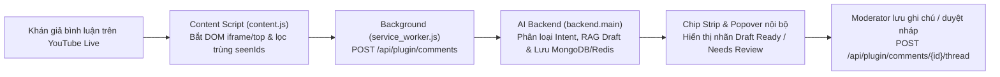

# Kiến trúc & Triển khai YouTube Live AI Comment Collector Extension

Tài liệu kỹ thuật mô tả kiến trúc và cơ chế hoạt động của **Chrome Extension YouTube Live Comment Collector** (`extension/`): thu thập bình luận thời gian thực với **hai công tắc độc lập** (`Enable Collector` và `Auto-Reply in Chat` — mặc định tắt auto-reply), hiển thị thanh chip lọc bình luận quan trọng, hộp thoại nháp nội bộ (`Draft Ready` / `Needs Review`) dành riêng cho người vận hành và hàng đợi gửi tin tuần tự (`chatSendQueue`) khi người vận hành bật `Auto-Reply in Chat`.

---

## 1. Mục tiêu & Nguyên lý Thiết kế
- **Hai Công Tắc Độc Lập (`Enable Collector` & `Auto-Reply in Chat`)**:
  - `Enable Collector` (`data-toggle="collector"`): Bật/tắt thu thập bình luận và hiển thị thanh chip/hộp thoại nháp nội bộ.
  - `Auto-Reply in Chat` (`data-toggle="auto-reply"`, mặc định **TẮT**): Chỉ khi người vận hành chủ động bật công tắc này, các bản nháp đủ điều kiện (`answer_draft.status === "answered"` và `needs_human_review === false`) mới được xếp vào hàng đợi gửi ra khung chat YouTube Live.
- **Tách biệt Ghi chú Nội bộ (`Save Note`) và Chat Công khai**:
  - Nút **`Save Note`** trong hộp thoại chi tiết chỉ gửi ghi chú/phê duyệt nội bộ về `POST /api/plugin/comments/{comment_id}/thread` và tuyệt đối **không** đẩy nội dung ghi chú ra khung chat công khai của YouTube Live.
- **Hàng đợi Gửi Tin Tuần Tự (`chatSendQueue`) & Kiểm tra DOM Hiện đại**:
  - Sử dụng hàng đợi `chatSendQueue` kèm khóa mutex `isProcessingChatQueue` và khoảng nghỉ `CHAT_SEND_COOLDOWN_MS = 1800ms` giữa các lần gửi để tránh race condition khi nhiều bình luận đến sát nhau.
  - Không ghi đè nếu streamer đang gõ dở trong ô chat (`document.activeElement === inputEl` và ô chat có chữ).
  - Kiểm tra trạng thái khung chat bị giới hạn (`yt-live-chat-restricted-participation-renderer`, Slow Mode, Subscribers-only, chưa đăng nhập) và sử dụng `InputEvent('beforeinput')` + `Range` + `InputEvent('input')` thay cho `document.execCommand('insertText')` đã lỗi thời, đồng thời kiểm tra xác nhận ô nhập đã được làm trống sau khi nhấn nút gửi (`chat_send_status`: `'sent' | 'failed' | 'blocked_or_restricted'`).
- **Giao diện hỗ trợ người vận hành (In-Page Operator Assistant UI)**:
  - Nút bật/tắt AI (`#livestream-ai-custom-button`) tích hợp trên thanh điều khiển trình phát YouTube cùng menu mở nhanh bảng điều khiển (`Open AI Dashboard` $\rightarrow$ `http://127.0.0.1:8000/dashboard`).
  - Thanh chip ngang (`#livestream-ai-message-row`) hiển thị tối đa 50 bình luận đáng chú ý đã qua lọc (loại bỏ spam/blocked/prompt injection).
  - Hộp thoại chi tiết nội bộ (`#livestream-ai-detail-popover`) hiển thị phân loại intent, nguồn trích dẫn (`sources`), nhãn trạng thái **`Draft Ready`** hoặc **`Needs Review`**, thông tin đơn hàng **`Order #ORD-LIVE-...`**, bản nháp gợi ý từ AI (`AI Draft`) và ô lưu ghi chú nội bộ của Moderator.
- **Thu thập thời gian thực (Real-time Ingestion)**: Lắng nghe khung chat native của YouTube (`yt-live-chat-item-list-renderer #items`), trích xuất bình luận (`id`, `sender`, `text`, `authorType`, `timestamp`) và đồng bộ về AI Backend (`POST /api/plugin/comments`).

---

## 2. Kiến trúc & Luồng Xử lý



---

## 3. Cơ chế Kỹ thuật Then chốt

### 3.1. Hỗ trợ Iframe Chat (`all_frames: true`) & SPA Navigation
- YouTube Live nhúng khung chat trong iframe (`iframe#chatframe` hoặc đường dẫn `/live_chat`).
- `manifest.json` cấu hình `"all_frames": true` giúp script chạy ở cả trang xem video (gắn nút điều khiển trên player) và trong iframe chat (thu thập bình luận & gắn thanh chip).
- Đồng bộ trạng thái bật/tắt (`AI_STATE_CHANGED`) giữa trang chính, iframe chat và `chrome.storage.session` theo từng tab.
- Lắng nghe `yt-navigate-finish` để tự động đồng bộ lại trạng thái khi chuyển video mà không cần tải lại trang.

### 3.2. Bóc tách Bình luận Thời gian thực & Khử trùng lặp
- **Container**: `yt-live-chat-item-list-renderer #items, #item-scroller #items`.
- **Selector tin nhắn**: `yt-live-chat-text-message-renderer, yt-live-chat-paid-message-renderer`.
- **Thông tin trích xuất**:
  - `id`: ID chuẩn hóa an toàn (`[A-Za-z0-9._@-]+`, tối đa 128 ký tự).
  - `sender`: Tên khán giả (`#author-name`).
  - `text`: Nội dung chat (`#message`).
  - `authorType`: Phân loại người gửi (`owner`, `moderator`, `member`, `viewer`).
- **Khử trùng lặp (`seenIds`)**: Tránh gửi trùng bình luận cũ khi DOM YouTube Live render lại.

### 3.3. Nhãn Trạng thái Rõ ràng (Không gây hiểu nhầm Auto-Reply)
- Khi bình luận cần người thật kiểm tra (`needs_human_review = true`), popover gắn nhãn **`Needs Review`**.
- Khi AI tạo được bản nháp có căn cứ (`answer_draft.status === "answered"`), popover gắn nhãn **`Draft Ready`** và hiển thị tin nhắn nháp dưới tên **`AI Draft`**.
- Mọi phản hồi trong popover chỉ lưu vào luồng trao đổi nội bộ (`POST /api/plugin/comments/{comment_id}/thread`) và cập nhật trạng thái duyệt nháp trong database (`seller_action`), **không bao giờ tự động gửi ra khung chat YouTube**.

---

## 4. Cấu trúc Thư mục

```text
extension/
├── manifest.json                  # Cấu hình Chrome Extension MV3
├── package.json                   # Metadata
└── src/
    ├── background/
    │   └── service_worker.js      # Kết nối AI Backend (/api/plugin/comments & /thread)
    └── content/
        ├── content.css            # Giao diện nút AI, thanh chip và popover nội bộ
        └── content.js             # Lắng nghe DOM YouTube Live, hiển thị Draft Ready / Needs Review
```
